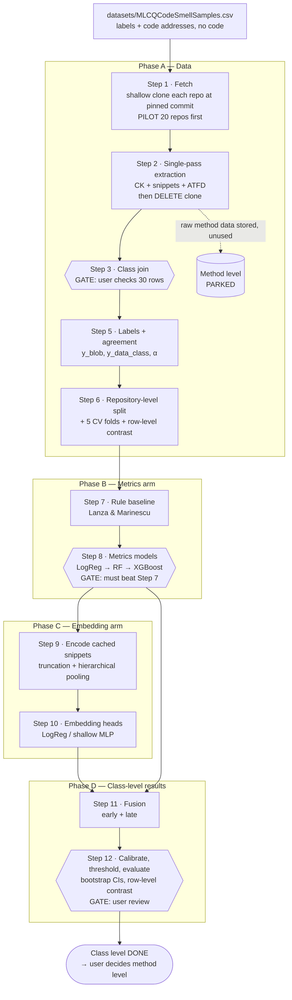

# Heuristic Hound — Pipeline Flow (up to class-level results)

> **Audience:** AI coding agents and the engineer building the project.
> **What this is:** the order in which things happen, what each stage reads and writes, and where the pipeline stops for a human check. It covers the project only, up to the end of class-level evaluation.
> **Requirements and rules:** [`PRD.md`](PRD.md). **Background:** [`heuristic-hound.md`](heuristic-hound.md). **Parameters:** [`config.yaml`](config.yaml).
> Method level is **parked**. It appears below only where Step 2 stores raw data for later use.
> **Data location:** generated data (`data/raw/…`, `data/processed/…` below) lives outside the repo in `~/HeuristicHound_local/` with the same layout; see `config.yaml` → `paths`. Split files and results stay in the repo under `eval/`.
> **Where we are (2026-10-25):** Stages 1–2 done for all 522 repos. Stage 3 **passed its gate** (2,340 / 2,340 matched; user sign-off 2026-10-25). Stages 5–7 are coded and tested but not run. Stages 8–12 are not built. One CK unit (eclipse/n4js, method samples only) is left `failed` and must be resolved before method level resumes. Status per step: PRD §0.1.

---

## 1. The whole flow at a glance



Hexagons are **gates**: the pipeline stops and the user must confirm before anything downstream runs.

---

## 2. Stage by stage

### Stage 0 — Starting point
- `datasets/MLCQCodeSmellSamples.csv` (semicolon-delimited). Each row = one reviewer's verdict on one smell for one code unit.
- It holds **no code and no features**, only *where* the code is: `repository`, `commit_hash`, `path`, `start_line`, `end_line`, `code_name`.
- Class level uses rows with `type == "class"`: 2,340 samples, 437 repositories, smells `blob` and `data class`.

### Stage 1 — Fetch (Step 1)
```
for each (repository, commit_hash) not yet "extracted" in the manifest:
    convert git@github.com:owner/name.git -> https://github.com/owner/name.git
    git init data/raw/<repo_key>
    git remote add origin <url>
    git fetch --depth 1 origin <commit_hash>
    git checkout FETCH_HEAD
    on failure -> record reason in unresolved.json, continue
```
- **Order:** the 437 class-level repos first, then the rest (D-7 in the PRD). Moved repos are fetched from their new address (`fetch.repo_aliases`); repos whose commit left GitHub come from the Software Heritage archive (`fetch.software_heritage_repos`). Same pinned commit either way.
- **Status (2026-10-13):** all 522 repos extracted (14 via new addresses, 9 via Software Heritage; PRD §4.3).
- **Pilot:** the first 20 repos, then stop and report disk, time and failures. The user authorizes the full run.
- Writes `data/raw/_progress_manifest.json` so the run can be resumed.

### Stage 2 — Single-pass extraction (Step 2)
Runs on each clone as soon as it is fetched, so disk never holds many clones at once.

```
clone ready
   │
   ├─► CK jar  ───────────────► data/processed/ck/<repo_key>/class.csv
   │     (vars+fields ON for     data/processed/ck/<repo_key>/method.csv   (stored for later, parked)
   │      TCC; crash → re-run    + class_supplement.csv (files lost to duplicate FQNs)
   │      per module/folder)
   │
   ├─► cut snippets ──────────► data/processed/snippets/<sample_id>.java   (class AND function samples)
   │
   ├─► javalang pass ─────────► data/processed/relational/<repo_key>.csv
   │                            class ATFD, FDP, NOPA, NOAM, WOC (rule inputs);
   │                            <repo_key>_method.csv: method ATFD/LAA/FDP per D-6 (stored, parked)
   │
   ├─► all outputs present? ── no ─► log failure, keep clone for retry
   │            │ yes
   ▼            ▼
manifest = "extracted"  ──►  DELETE clones/<repo_key>
```
**The clone is deleted only after every output exists.** Snippets are what the embedding arm will use later, so Phase C needs no repo access.
**Result:** 522 / 522 extracted. 2,308 / 2,340 class and 2,384 / 2,430 method snippets; the 78 gaps are samples whose `path` does not exist at the pinned commit.

**Targeted recovery (no re-clone):** `recover_extraction.py` fetches only the files a failed output needs, at the pinned commit (GitHub contents API, blob SHA verified), per the list in `extraction.recoveries`:
```
CK crashed on a unit ──► re-run CK without the trigger file ──► ck/<repo_key>/class_recovered.csv
                                                                 (SapMachine javac/comp: JDT NPE)
javalang parse error ──► re-analyse with relational.py retries ─► rows replaced in relational/<repo_key>.csv
                         (Type[]::new, Map<K, @Nullable V>)      (13 files; 0 parse errors left)
every action ─────────────────────────────────────────────────► _recovery_log.json
```
Left `failed`: eclipse/n4js CK unit (out of memory on a 6.37 MB generated parser; 4 method samples). Resolve before method level resumes.

### Stage 3 — Class join (Step 3) · GATE
```
MLCQ class samples (2,340)          CK class.csv rows (all repos)
        │                                    │
        │  normalize names: Outer.Inner  ⇄  Outer$Inner   (24% of samples are nested)
        ▼                                    ▼
   key 1: code_name + commit_hash  ──match──►  row
   key 2: raw CK name (top-level class with '$' in its name, e.g. tomee InitMethod$JAXB) ─► row
   key 3 (fallback): path suffix + class name ─►  row
        │
        ├─► data/processed/class_dataset.parquet   (sample_id + CK metrics + ATFD + working_link)
        ├─► data/processed/join_report.json        (match rate, unmatched by reason, key used, link checks)
        └─► data/processed/join_manual_check.csv   (30 matched rows, same ids on every re-run, + HTTP status)

check_links.py ─► data/processed/link_check.csv   (HTTP status of every working_link)
```
**STOP.** The user checks the 30 rows by hand. Nothing after this point runs until the user says the join is correct.
**Result (2026-10-25):** **2,340 / 2,340 matched** (name 2,337, path suffix 2, raw name 1); 0 missing ATFD; LOC Spearman 0.94; median TCC 0.17; all 2,340 `working_link`s HTTP 200; 30/30 rows verified. **Gate passed — user sign-off 2026-10-25**, `gates.join_class_verified: true`.

### Stage 5 — Labels and agreement (Step 5)
```
class annotation rows (8,040)
   │ group by (sample_id, smell), take max severity
   ▼
severity per sample per smell
   │ binarize by config labels.minor_severity_rule  (D-1 = minor_plus)
   ▼
y_blob (506 positive)   y_data_class (485 positive)      ← primary, minor_plus  (α 0.359 / 0.431)
y_blob (286)            y_data_class (311)               ← sensitivity, major_critical_only (α 0.273 / 0.339)
   │
   ├─► labels_class.parquet  (primary labels + annotator-filtered + high-confidence variants)
   └─► eval/results/agreement_*.json  (Krippendorff's α per smell)
```
Models train on the primary labels only. The other variants are for analysis. The sensitivity rule (`labels.sensitivity_severity_rules`) still has to be wired into `labels.py`.

### Stage 6 — Splits (Step 6)
```
437 class repositories
   │ group by repository, 80/20, seeded
   │ check test positive rate within ±2 pp for both smells
   ▼
TRAIN repos (349, 1,753 samples)   TEST repos (88, 587 samples)   ◄── touched once per final model
   (seed 42 passes the ±2 pp check under minor_plus: test Blob 23.6% vs 21.7%, Data Class 20.9% vs 20.7%)
   │
   │ StratifiedGroupKFold(5, groups=repository)
   ▼
5 CV folds (train/val repos)  ── used for tuning, calibration, thresholds, stacking

separately: row-level stratified split, marked CONTRAST_ONLY → used only in Step 12
```
Split files go to `eval/splits/`. Every arm reads the same files. Code asserts that no repository appears on both sides.

### Stage 7 — Rule baseline (Step 7)
```
class_dataset (CK + ATFD) ─► fixed rules from config ─► predictions on TEST ─► results file
God Class:  ATFD > 5 AND WMC ≥ 47 AND TCC < 1/3                           (D-4: PMD 7 thresholds)
Data Class: WOC < 1/3 AND ((NOPA+NOAM > 3 AND WMC < 31) OR (NOPA+NOAM > 5 AND WMC < 47))
```
No learning. This is the bar every learned model must clear.

### Stage 8 — Metrics arm (Step 8) · GATE
```
features: WMC LOC NOM NOF CBO RFC LCOM LCOM* TCC LCC DIT NOC fan-in fan-out ATFD
   │
   for smell in {blob, data class}:                 (one binary classifier each)
       for model in LogReg → RandomForest → XGBoost (→ LightGBM):
           tune on the 5 CV folds (train repos only)
           fit on all train repos, 5 seeds
           score TEST once  ─► results file (mean ± std)
```
**GATE:** the best metrics model must beat the rule baseline on F1 and MCC for both smells. If not, stop and report.

### Stage 9 — Encode (Step 9)
```
data/processed/snippets/<sample_id>.java   (class samples only)
   │
   ├─ truncation:   tokenize → first 512 tokens → frozen encoder → 1 vector
   │
   └─ hierarchical: parse snippet into methods → each method (≤512 tokens) → frozen encoder
                    → mean-pool over methods → 1 vector
                    (no parseable methods → fall back to truncation, log it)
   ▼
data/processed/embeddings/<encoder>/<strategy>/   + truncation-rate log per smell
```
CPU only, batched, cached, resumable. Encoder choice is D-3.

### Stage 10 — Embedding arm (Step 10)
Same loop as Stage 8 with embedding vectors as input and heads {LogReg, shallow MLP}. Same split, folds, seeds and metrics. Both strategies are reported.

### Stage 11 — Fusion (Step 11)
```
early:  scale(metrics) ⊕ PCA_50(embedding)  ─► classifier
        (scaler and PCA fitted inside training folds only)

late:   out-of-fold scores from metrics arm ┐
        out-of-fold scores from embedding arm ┴─► logistic-regression stacker
```
Never take the per-sample max of the two arms' scores.

### Stage 12 — Final evaluation (Step 12) · GATE
```
for each arm (rule, metrics, embedding×2 strategies, fusion) and smell:
    isotonic calibration      ← fitted on CV folds of TRAIN repos
    global threshold          ← max F1 on out-of-fold predictions, then FROZEN
    score TEST once           ← F1, MCC, PR-AUC
    bootstrap 95% CI          ← resample TEST repositories
paired bootstrap between arms
per-repository breakdown
row-level contrast: rerun final pipeline on CONTRAST_ONLY split → report delta
(stretch) CrowdSmelling inference with the winning arm
   ▼
eval/results/class_level_final_<timestamp>.json
```
**STOP.** The user reviews the results. That is the end of class level.

---

## 3. Data that flows between stages

| From → To | Artifact | Key |
|---|---|---|
| CSV → 1 | `(repository, commit_hash)` list | repo |
| 1 → 2 | clone in `data/raw/<repo_key>` (temporary) | repo |
| 2 → 3 | `ck/<repo_key>/class.csv`, `relational/<repo_key>.csv` | class name + file path |
| 2 → 9 | `snippets/<sample_id>.java` | `sample_id` |
| 3 → 5, 7, 8 | `class_dataset.parquet` | `sample_id` |
| 5 → 6, 7, 8, 10 | `labels_class.parquet` | `sample_id` |
| 6 → 7–12 | `eval/splits/*.json` (repo lists) | `repository` |
| 9 → 10, 11 | embedding vectors | `sample_id` |
| 8, 10 → 11 | out-of-fold predictions | `sample_id` |
| 7–12 → user | `eval/results/*.json` | one file per run |

`sample_id` is the join key for everything after Step 3. `repository` is the grouping key for every split.

---

## 4. Where the pipeline stops for a human

| Stop | After | The user checks | Blocks |
|---|---|---|---|
| Pilot review | Step 1 pilot (20 repos) | disk, time, failure rate | full fetch |
| D-1, D-4, D-6, D-7 resolved | before the steps that need them | decisions in PRD §9 | those steps — **all four resolved**; D-3, D-8 (Step 9) and D-9 (Step 12) still open |
| **GATE** join | Step 3 | 30 matched rows are correct | Steps 5–12 — **passed 2026-10-25** |
| n4js CK unit | Step 2 | resolve the `failed` unit (CK out of memory) | method level |
| **GATE** metrics | Step 8 | learned model beats rule baseline | Phase C |
| **GATE** final | Step 12 | full class-level results | method level, paper |

---

## 5. After class level (not planned yet)
Method level (Long Method, Feature Envy) resumes **only after** the Step 12 gate passes. The raw data it needs (`method.csv`, function snippets, any method-level relational data per D-6) will already be on disk from Step 2, so no re-clone is needed. Its design is intentionally left open.
